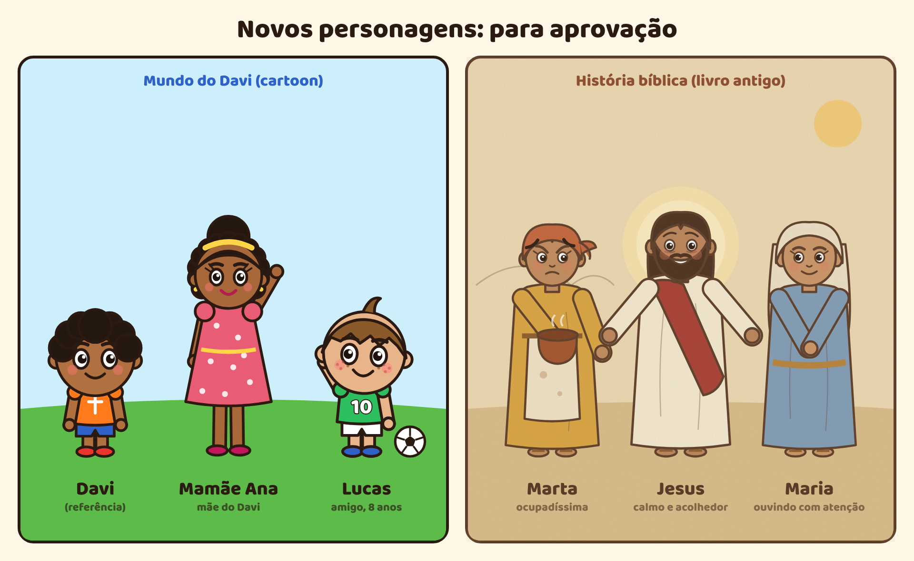

# Personagens

Estilo: **cartoon clássico com contorno**. O contorno é marrom-escuro e grosso, a cabeça é grande e os olhos são expressivos. As cores são vivas.

| Personagem | Quem é | Visual | Voz (gratuita, edge-tts) |
|---|---|---|---|
| **Davi** | 7 anos, alegre, curioso e um pouco impulsivo. Tem bom coração, mas se distrai fácil. | Cabelo cacheado preto, camiseta laranja com uma cruz branca, short azul, tênis vermelhos. | Francisca com tom mais agudo (+30 Hz) e um pouco mais rápida (+5%). |
| **Algodão** | Ovelhinha de estimação do Davi. Não fala, só bale. Fiel e brincalhona. | Lã branca em "nuvenzinhas", cara e patas marrom-escuro, topete de lã. | Balido sintetizado ("Béééé"). |
| **Vovô Elias** | Avô do Davi. Sábio, paciente e brincalhão. Ensina com exemplos do dia a dia. | Careca com cabelo branco nas laterais, bigode branco, óculos redondos, cardigã verde. | Antonio, mais grave (−12 Hz) e pausado (−12%). |
| **Mamãe Ana** | Mãe do Davi. Carinhosa e paciente. | Cabelo cacheado em coque com faixa amarela, brincos dourados, vestido rosa de bolinhas, sapatilhas pink. | Francisca ou Thalita, com voz normal. |
| **Lucas** | 8 anos, melhor amigo do Davi. Animado, adora futebol e é leal. | Cabelo liso castanho com franja e topete, sardas, camisa verde de futebol nº 10, short branco, tênis azuis, sempre com uma bola. | Antonio com tom agudo (a testar). |
| **Marta, Maria e Jesus** | Personagens da história bíblica contada pelo Vovô (Lucas 10). | Estilo de livro ilustrado antigo: contorno marrom mais fino, tons de areia e terracota e textura de papel. **Marta:** lenço terracota, túnica ocre, avental manchado e panela na mão. **Maria:** véu creme, túnica azul-acinzentada e mãos juntas. **Jesus:** túnica clara, faixa vermelha, cabelo e barba castanhos, sorriso acolhedor, braços abertos e uma luz suave atrás. | A definir. |
| **Narradora** | Conta a história. | — | Thalita (−5% de velocidade). |

### Por que esses nomes?
- **Davi:** o menino pastor que colocou Deus em primeiro lugar diante de Golias.
- **Algodão:** a ovelha lembra o Bom Pastor (Salmo 23 e Lucas 15) e a lã branca lembra Isaías 1:18. Também é um nome fofo para crianças.
- **Elias:** o profeta que confrontou os "outros deuses" no Monte Carmelo (1 Reis 18). Ele mostrou ao povo que só o Senhor merece o nosso coração inteiro.
